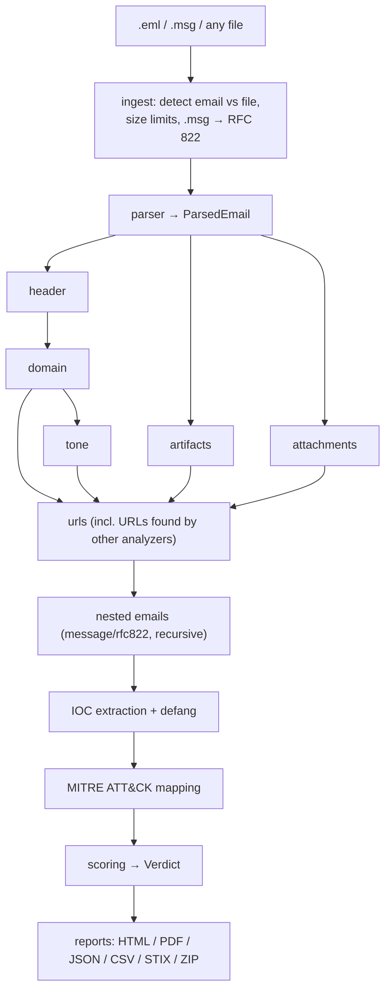

# PhishLens architecture

This document covers:
- how a submission becomes a verdict;
- what each analyzer does;
- the contract every analyzer follows;
- how scoring and identity binding work;
- where the tunable data lives.

Design decisions and their reasons are in [DECISIONS.md](DECISIONS.md).

## Flow



`phishlens/pipeline.py` runs the steps in this order:
1. The header analyzer runs first, because others need its authentication results.
2. Domain and then tone run in sequence, because tone skips brands the domain analyzer has
   already reported. Artifacts and attachments run alongside them.
3. The URL analyzer runs last. It picks up every URL the other analyzers returned in
   `extracted_urls`.

Every analyzer has a timeout (`ANALYZER_TIMEOUT_SECONDS`, `ATTACHMENT_TIMEOUT_SECONDS`).
Progress is reported per module, and the API and UI show it live.

A standalone file (`analyze_file`) runs only attachments, URLs (for the URLs found inside it),
IOC extraction, MITRE mapping and scoring, with the `file` thresholds.

The same pipeline serves all three front ends:
- **CLI** (`phishlens/cli.py`) calls it directly.
- **API** (`api/`) stores the upload under `quarantine/uploads/<case id>/` and queues a job
  (RQ/Redis, or in-process with `JOB_QUEUE=sync`). The worker runs the pipeline and writes the
  reports.
- **UI** (`ui/`) talks only to the API.

## The analyzer contract

```python
async def analyze(email: ParsedEmail) -> AnalyzerResult
```

- **Never raises.** Exceptions are caught and added to `AnalyzerResult.errors` as text; the
  rest of the result stays usable. Confidence is the share of modules that ran without
  errors.
- **Findings** (`phishlens.models.Finding`):
  - `id`: stable snake_case, e.g. `replyto_mismatch`. Weights, MITRE rules, tests and the ML
    feature export refer to it, so never rename an ID without updating `data/` and the tests.
  - `module`, `title`, `description`, `severity` (`info` … `critical`).
  - `evidence`: a dict of the facts behind the finding, shown in reports.
  - `score`: points, filled in by the scorer.
- **`raw`** holds module data for report tables (auth summary, URL rows, attachment rows,
  highlights, …).
- **`extracted_urls`** returns URLs the module discovered (HTML, attachments, QR codes) so the
  URL analyzer and IOC extraction see them.
- **Missing configuration is not an error.** Without an API key the check is skipped (the
  client answers `not_configured`) and the report lists the service under "not configured".
- **No network of their own.** Analyzers never create HTTP clients or resolvers. Every
  external call goes through `phishlens/enrichment/`, which provides:
  - a SQLite cache (TTL per service);
  - a token-bucket rate limit per service, and retries with backoff;
  - secret redaction.
  The context switches `offline()` and `cache_only()` (in `enrichment/network.py`) turn
  network access off, or limit lookups to the cache.

## The analyzers

### header (`analyzers/header.py`)

- **Authentication-Results.** Headers from untrusted servers are listed but not believed.
  `forged_auth_results_header` flags ones that claim a result for a domain they cannot vouch
  for.
- **SPF** is evaluated again for the originating external IP from the Received chain
  (`spf_fail`, `spf_softfail`, `spf_none`, `spf_error`).
- **DKIM** signatures are verified, together with their quality:
  - `dkim_invalid`, `dkim_none`;
  - `dkim_body_length_tag` (`l=` allows appended content);
  - `dkim_unsigned_critical_headers`, `dkim_expired_or_old`.
- **DMARC** policy is fetched, and **alignment is computed in-house** (relaxed/strict, using
  the organizational domain):
  - `dmarc_fail`, `dmarc_none_record`, `dmarc_policy_none`;
  - `spf_pass_unaligned`, `dkim_pass_unaligned`;
  - `auth_but_unaligned`: SPF or DKIM passed, but only for domains other than the From domain.
    This is the classic spoof that "passes authentication".
- **ARC** chains are verified. A trusted ARC sealer (a known forwarder or mailing list)
  downgrades failures that forwarding explains (`arc_trusted_forward`).
- **Bulk-mail providers** (`data/esp_domains.yaml`): `esp_unaligned` flags mail sent through an
  ESP without alignment.
- **Structure:**
  - `multiple_from_headers`;
  - `display_name_contains_address` / `display_name_contains_email`;
  - `received_chain_anomaly`, `received_out_of_order`, `received_parse_error`.
- `raw["auth_summary"]` has one row per mechanism with its aligned domain. `raw["header_verdict"]`
  is the one-line verdict: `ok`, `likely_forward`, `spoofing`, `fail` or `unknown`.

### domain (`analyzers/domain.py`)

- **Consistency** between From, Reply-To, Return-Path and Sender: `replyto_mismatch`,
  `replyto_free_webmail`, `returnpath_mismatch`, `from_is_free_webmail`.
- **Lookalikes** (`lookalike_domain`, `brand_in_subdomain`). Each sender and link domain is
  compared with the brand registry by:
  - Damerau-Levenshtein distance on the domain label;
  - a Unicode confusables skeleton (homoglyphs, punycode/IDN);
  - TLD swaps and brand-plus-word combinations.
  Generic brand labels (`office`, `live`) only match through homoglyphs.
- **Display-name spoofing** (`display_name_brand_spoof`): a brand name in the display name,
  with an address that does not belong to the brand.
- **Domain age** via RDAP: `domain_age_under_7_days`, `_under_30_days`, `_under_180_days`.
  **MX**: `from_domain_no_mx`.
- **Identity binding** (`brand_impersonation`), described below.

### tone (`analyzers/tone.py`, `tone_ml.py`)

- **Lexicons.** Categories from `data/lexicons/*.yaml` are matched in the normalized text:
  `tone_urgency`, `tone_fear`, `tone_greed`, `tone_authority`, `secrecy_request`,
  `generic_greeting`, `credential_request` and `payment_request`. Points grow with the number
  of distinct phrases, up to a cap. `raw["highlights"]` gives the matched phrases for the UI.
- **Optional layers:**
  - a local transformer model (`TONE_MODEL_PATH`, `ml_phishing_probability_high`);
  - Claude (`LLM_TONE_ENABLED`, `llm_impersonation`). This sends the email text to Anthropic,
    and the report says so.

### urls (`analyzers/urls.py`)

- **Sources.** Links come from the text, HTML hrefs, forms, attachments and QR codes, with the
  visible text they were shown under.
- **Static checks:**
  - `ip_address_url`, `url_shortener`, `risky_tld`, `punycode_url`, `at_sign_in_url`;
  - `excessive_subdomains`, `data_or_javascript_uri`, `credential_keywords`;
  - `brand_in_unrelated_domain`, `link_text_mismatch` (the text shows one domain, the link
    goes to another).
- **Reputation** runs in order and stops at the first malicious answer (`url_known_malicious`,
  `url_suspicious_reputation`): Google Safe Browsing, URLhaus, VirusTotal.
- **urlscan.io** scans run unlisted by default. They give the final URL, a screenshot and
  whether there is a login form: `redirect_to_different_domain`,
  `urlscan_login_page_on_unrelated_domain`. The page is loaded by urlscan, never by
  PhishLens.
- Allowlisted domains (`data/url_allowlist.yaml`) skip reputation lookups.

### attachments (`analyzers/attachments.py` and helpers)

- **`filetype.py`**: identifies files by magic bytes (libmagic, or built-in signatures as a
  fallback). Checks `type_mismatch`, `double_extension`, `rtlo_filename`,
  `whitespace_padded_extension` and `high_risk_file_type`.
- **`archives.py`**: unpacks zip (including AES), 7z, tar, gzip and ISO in memory within a
  budget (depth, count, total size, compression ratio), so a zip bomb stops at
  `archive_limit_exceeded`. Passwords found in the email body are tried:
  - `encrypted_archive_password_in_body` when one works;
  - `encrypted_archive_unopened` when none does.
- **`office.py`** (oletools, msoffcrypto):
  - `office_macro_autoexec`, `office_macro_suspicious_calls`, `xlm_macro`;
  - `remote_template_injection`, `office_external_link`;
  - `encrypted_office_document`, `rtf_embedded_object`.
- **`documents.py`**:
  - PDF: `pdf_javascript`, `pdf_launch_action`, `pdf_auto_action`, `pdf_embedded_file`;
  - HTML/SVG: `html_smuggling`, `credential_form_attachment`, `obfuscated_script`,
    `svg_script`.
- **`binaries.py`**: `pe_executable_attachment`, `pe_packed`, `lnk_suspicious_command`.
- **`qr.py`**: decodes QR codes in images and PDFs (`qr_code_url`); the URLs go to the URL
  analyzer.
- **YARA** rules from `data/yara/` (`yara_match`).
- **Hash reputation** (MalwareBazaar, VirusTotal): `attachment_known_malicious`. Deep analysis
  is skipped for files already known to be malicious.
- **Optional sandbox** (Hybrid Analysis or CAPE): `sandbox_malicious`, `sandbox_suspicious`.
  Files are uploaded only when the upload switch is on.
- **Quarantine.** Every attachment is stored in an AES-encrypted zip under
  `quarantine/<case id>/`.

### artifacts (`analyzers/artifacts.py`)

- **HTML tricks:**
  - `hidden_text`, `hidden_filler_text`, `zero_width_characters`;
  - `tracking_pixel`, `text_html_mismatch`, `encoded_link`, `script_in_body`, `meta_refresh`.
- **Header oddities:**
  - `missing_message_id`, `missing_date`, `date_in_future`, `date_too_old`;
  - `message_id_domain_mismatch`;
  - `suspicious_mailer` (`data/suspicious_mailers.yaml`).

### nested emails

Attached or forwarded messages (`message/rfc822`) are analyzed recursively, up to
`NESTED_EMAIL_MAX_DEPTH`. Their findings are collected in the `nested` module, which has its
own cap, and marked `evidence["nested"]`.

## Identity binding

Most spoofing checks look at one thing at a time. Identity binding asks one combined question:
**does the brand this email claims to be match the domain that actually authenticated it?**

1. **Claimed brands** come from the brand registry (`data/brand_registry.yaml`), matched as
   whole words in:
   - the From display name (`display_name`);
   - a lookalike sender domain (`lookalike`);
   - the subject (`subject`);
   - the body (`body`). Body claims are bound by the tone analyzer, which reads the text, for
     brands the domain analyzer has not already covered.
2. **The sender identity** is the From domain, together with whether DMARC alignment
   succeeded. This is taken from the header analyzer's recomputed auth summary, never from
   `Authentication-Results`.
3. For every claimed brand, the sender **is** that brand only when all of these hold:
   - its domain is one of the brand's legitimate domains, or a subdomain of one;
   - it is not a free webmail domain;
   - it is not known to be unauthenticated.

   Otherwise a `brand_impersonation` finding is raised.

| Sender domain | Authenticated (DMARC-aligned)? | Brand claimed in | Result |
|---|---|---|---|
| a legitimate brand domain | yes, or unknown | anywhere | no finding (it really is the brand) |
| a legitimate brand domain | **no** | anywhere | `brand_impersonation`, high: uses the brand's domain but did not authenticate as it |
| free webmail (`gmail.com`, …) | any | display name / lookalike | `brand_impersonation`, high |
| unrelated domain | any | display name / lookalike | `brand_impersonation`, high |
| unrelated domain | any | subject or body only | `brand_impersonation`, medium (a weak claim) |
| **lookalike** or **newly registered** domain | any | anywhere | `brand_impersonation`, **critical** |

- Together with `auth_but_unaligned`, identity binding triggers the `spoofed_brand` override:
  the verdict is always Malicious.
- Your own organization can be protected the same way: list its domains under
  `organization` in the brand registry.

## Scoring (`phishlens/scoring/`, `data/weights.yaml`)

1. **Points per finding.** `weights` gives each finding ID a number, or a map by severity
   (`{high: 25, medium: 15}`). Findings without a weight use `severity_fallback`
   (`info 0, low 5, medium 15, high 30, critical 50`). Some points are scaled:
   - tone findings, by how many distinct phrases matched;
   - ML findings, by their probability;
   - findings downgraded by a trusted ARC forward drop to their severity fallback.
2. **Module caps** (`module_caps`) limit what one module can add. For example, tone can add at
   most 30, so a very pushy but harmless newsletter cannot become Malicious on tone alone.
3. **Total** = the sum of the capped module scores, clamped to 0–100.
4. **Thresholds** per case type: email is Suspicious from 30 and Malicious from 60; a file is
   Suspicious from 20 and Malicious from 50.
5. **Overrides** force a minimum label and raise the score to that label's threshold:

   | Override | Condition | Label |
   |---|---|---|
   | `known_malicious_attachment` | `attachment_known_malicious` | malicious |
   | `known_malicious_url` | `url_known_malicious` | malicious |
   | `sandbox_malicious` | `sandbox_malicious` | malicious |
   | `html_smuggling` | `html_smuggling` | malicious |
   | `spoofed_brand` | `auth_but_unaligned` **and** `brand_impersonation` | malicious |
   | `critical_finding` | any critical finding | suspicious |

6. **Confidence** is the share of modules that ran without errors, minus 0.1 for each key
   reputation service (VirusTotal, Safe Browsing, abuse.ch) that is not configured (at most
   0.3), and never below 0.1.
7. **Top findings.** The five highest-scoring findings become the "why" in every report.

`SCORER=ml` switches to a trained scorer (`scoring/ml_scorer.py`) built from features exported
by `scripts/export_features.py`. The rule scorer remains the default.
`scripts/evaluate.py --tune` shows how other thresholds would change precision and recall on a
labelled dataset.

## MITRE ATT&CK (`phishlens/mapping/`, `data/mitre_rules.yaml`)

- Rules map finding IDs to technique IDs:
  - `any_of` / `all_of`, where an inner list means "one of these";
  - optional evidence filters.
- Names, tactics and URLs come from the local ATT&CK data (`scripts/update_attack_data.py`,
  gitignored). Without it, the fallback table in the rules file is used.
- Each technique lists the findings that triggered it.

## IOCs and reports

- **IOCs.** `phishlens/ioc/` extracts URLs, domains, IPs, email addresses, hashes and file
  names. It normalizes them, skips private/reserved IPs and `TRUSTED_INTERNAL_HOSTS`, keeps
  the reputation verdict, and stores the original value plus a defanged form. Exports: CSV, JSON and a STIX
  2.1 bundle.
- **HTML reports.** `phishlens/reporting/` renders Jinja2 templates whose `finalize` hook
  defangs every string. The only exceptions are two wrappers:
  - `Plain`, for values known to be safe;
  - `Link`, which is clickable only for attack.mitre.org and urlscan.io.
- PDF is the same HTML rendered by WeasyPrint. The executive summary and recommended actions
  are built from the findings (`reporting/summary.py`).

## Data files and how to extend them

All tables live in YAML and are loaded through cached loaders (`phishlens/data_loader.py`).
Editing a file needs no code change; restart the API or worker to reload it.

| File | What it holds | To extend |
|---|---|---|
| `data/brand_registry.yaml` | brands (keywords, legitimate domains, ESPs), generic labels, your organization | add a brand with its keywords and every domain it really sends from |
| `data/weights.yaml` | points, caps, thresholds, overrides, confidence | change a weight; add a weight for a new finding ID; add an override |
| `data/mitre_rules.yaml` | finding → technique rules and fallback technique names | add a rule for a new finding ID |
| `data/lexicons/*.yaml` | tone phrases per category | add phrases (lowercase); keep them specific |
| `data/esp_domains.yaml` | bulk-mail providers | add the provider's sending domains |
| `data/free_webmail.yaml` | free mailbox domains | add domains |
| `data/risky_tlds.yaml`, `data/shorteners.yaml`, `data/url_keywords.yaml`, `data/url_allowlist.yaml` | URL checks | add entries |
| `data/confusables.yaml` | homoglyph map for lookalike detection | add character mappings |
| `data/file_types.yaml`, `data/executable_indicators.yaml`, `data/password_hints.yaml` | attachment checks | add signatures, extensions, password phrases |
| `data/suspicious_mailers.yaml` | X-Mailer values of phishing kits / bulk tools | add patterns |
| `data/yara/*.yar` | YARA rules (or `YARA_RULES_DIR`) | drop in `.yar` files |
| `ui/services.yaml` | services on the UI Settings page | add an entry when a new service is added |

### Adding a new check

1. Emit a `Finding` with a new stable snake_case ID from the analyzer that owns the area. Put
   the facts in `evidence`.
2. Add its weight to `data/weights.yaml` (or rely on the severity fallback). Add a MITRE rule
   if it maps to a technique.
3. Add a synthetic fixture or unit test. Tests mock all network (`respx` for HTTP,
   `monkeypatch` for DNS); a test that tries a real connection fails.
4. Record any non-obvious choice in `docs/DECISIONS.md`.
