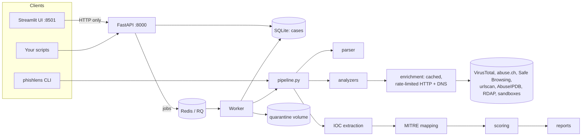
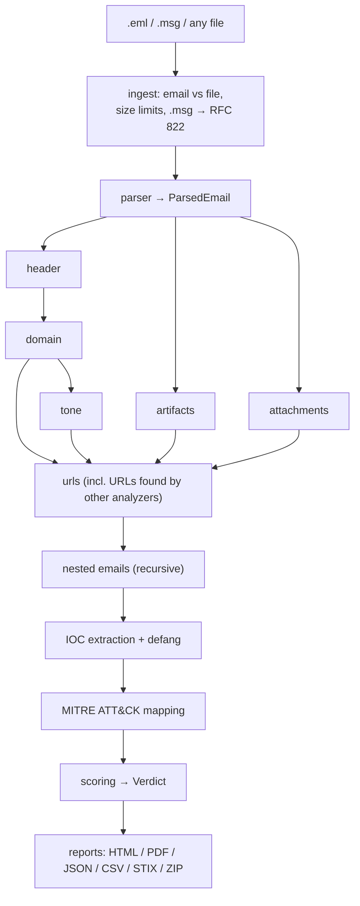

# PhishLens: complete project details

> Automated, explainable phishing email analysis. Upload one email and get a full investigation
> in a single report.

| | |
|---|---|
| **Project** | PhishLens (minor project) |
| **Language** | Python 3.11 |
| **License** | MIT |
| **Repository** | <https://github.com/rahulllyadavvv/PhishLens> |
| **Size** | ~16,300 lines of application code (`phishlens/`, `api/`, `ui/`, `scripts/`), ~10,900 lines of tests |
| **Tests** | 59 test modules, 1,081 tests passing (all network mocked) |
| **Build history** | 15 phases (P0–P15), 56 steps, built 2026-09-23 → 2026-09-25 |
| **Interfaces** | Typer CLI, FastAPI REST API, Streamlit web UI |

---

## Table of contents

1. [What PhishLens does](#1-what-phishlens-does)
2. [Key features and what makes it different](#2-key-features-and-what-makes-it-different)
3. [Tech stack](#3-tech-stack)
4. [Folder structure](#4-folder-structure)
5. [Architecture and processing flow](#5-architecture-and-processing-flow)
6. [Data models](#6-data-models)
7. [The analyzers in detail](#7-the-analyzers-in-detail)
8. [Identity binding](#8-identity-binding)
9. [Threat-intelligence enrichment](#9-threat-intelligence-enrichment)
10. [Scoring and verdict](#10-scoring-and-verdict)
11. [MITRE ATT&CK mapping](#11-mitre-attck-mapping)
12. [IOCs and reports](#12-iocs-and-reports)
13. [Interfaces: CLI, API, UI](#13-interfaces-cli-api-ui)
14. [Configuration reference](#14-configuration-reference)
15. [Data files](#15-data-files)
16. [Safety design](#16-safety-design)
17. [Installation and deployment](#17-installation-and-deployment)
18. [Testing, quality and CI](#18-testing-quality-and-ci)
19. [Evaluation](#19-evaluation)
20. [Development history](#20-development-history)
21. [Limitations and future work](#21-limitations-and-future-work)
22. [Glossary](#22-glossary)

---

## 1. What PhishLens does

PhishLens is a self-hosted tool for investigating suspicious emails. A user submits:

- an email file: `.eml` (RFC 822) or Outlook `.msg`;
- pasted raw email source; or
- any single suspicious file (zip, Office document, PDF, executable, …).

PhishLens runs a **static** investigation (nothing is opened, executed or fetched on the host)
across seven areas:

| # | Area | Question it answers |
|---|---|---|
| 1 | Parsing | What is in this message: headers, addresses, bodies, links, attachments? |
| 2 | Header authentication | Did SPF, DKIM, DMARC and ARC really pass, and for which domain? |
| 3 | Sender and domain | Is the sender who it claims to be? Lookalike, new or spoofed domain? |
| 4 | Body tone | Does the text use urgency, fear, rewards or ask for passwords/payment? |
| 5 | URLs | Are the links deceptive or known to be malicious? |
| 6 | Attachments | Are the files dangerous: macros, smuggling, executables, known malware? |
| 7 | Hidden artifacts | Hidden text, zero-width characters, tracking pixels, header oddities? |

It then enriches indicators with free threat-intel services and produces:

- a **verdict**: **Clean / Suspicious / Malicious**, a **score from 0 to 100** and a
  **confidence** value;
- the **top 5 reasons** for the verdict;
- a **defanged IOC table** (URLs, domains, IPs, email addresses, hashes, file names);
- a **MITRE ATT&CK mapping** with the findings that triggered each technique;
- reports in **HTML, PDF, JSON, CSV, STIX 2.1 and a ZIP bundle**, with an executive summary and
  recommended actions.

**Target users:** SOC analysts, IT/security teams and students who need a fast, explainable
second look at reported phishing.

---

## 2. Key features and what makes it different

- **Identity binding.** Compares *who the email claims to be* (brand in the display name, a
  lookalike domain, subject, body) with *who actually authenticated it* (the DMARC-aligned From
  domain). An email claiming to be PayPal but authenticating as `paypa1-secure.example` is caught
  even when every individual check passes.
- **Alignment is recomputed, never trusted.** SPF, DKIM and ARC are re-verified and DMARC
  alignment is computed in-house, instead of trusting the `Authentication-Results` header, which
  an attacker can forge.
- **Explainable scoring.** Every point comes from a named finding with a weight in
  `data/weights.yaml`. Module caps and override rules are transparent and listed in the report.
- **Deep static attachment analysis.** Archives (zip, AES zip, 7z, tar, gz, ISO) unpacked in
  memory with zip-bomb limits and passwords taken from the email body; Office macros, XLM,
  template injection, PDF actions, HTML smuggling, SVG scripts, PE/LNK files, QR codes and YARA.
- **Analyst-ready output.** Defanged IOCs (CSV/JSON), STIX 2.1 bundle, MITRE techniques,
  HTML/PDF report.
- **Free and self-hosted.** Every external service is optional and has a free tier. Without
  keys, all local checks still run; confidence is lowered.
- **Private and safe by default.** Static only, no file uploads without consent, keys never
  logged, every malicious value defanged.
- **Three front ends, one pipeline.** CLI, REST API with a job queue, and a web UI.

---

## 3. Tech stack

| Area | Libraries / tools |
|---|---|
| Core / config | `pydantic`, `pydantic-settings` (settings from env / `.env`), `pyyaml` |
| Email parsing | stdlib `email`, `extract-msg` (Outlook `.msg`), `beautifulsoup4` (HTML bodies) |
| Email authentication | `pyspf` (SPF), `dkimpy` (DKIM + ARC), `checkdmarc` (DMARC records), `authres` (Authentication-Results), `dnspython` |
| Domain analysis | `tldextract` (registrable domain), `rapidfuzz` (Damerau-Levenshtein), Unicode confusables map |
| File type | `python-magic` (libmagic) with a built-in signature fallback |
| Archives | `py7zr` (7z), `pyzipper` (AES zip), `pycdlib` (ISO), stdlib `zipfile` / `tarfile` / `gzip` |
| Office | `oletools` (olevba, macros, RTF), `msoffcrypto-tool` (encrypted Office) |
| PDF / binaries | `pypdf`, `pefile` (Windows PE), `LnkParse3` (shortcut files) |
| Signatures / images | `yara-python`, `pyzbar` + `Pillow` (QR codes) |
| IOCs / formats | `iocextract`, `stix2`, `mitreattack-python` |
| HTTP | `httpx` (async) with SQLite cache, token-bucket rate limits, retries |
| Reports | `jinja2`, `weasyprint` (HTML → PDF) |
| Backend | `fastapi`, `uvicorn`, `python-multipart`, `sqlmodel` (SQLite case store), `redis` + `rq` (job queue) |
| Frontend / CLI | `streamlit`, `typer`, `rich` |
| Optional ML | `transformers`, `torch`, `accelerate` (local tone classifier); scikit-learn-style ML scorer |
| Optional LLM | `anthropic` (Claude second opinion on tone/impersonation) |
| Dev / test | `pytest`, `pytest-asyncio`, `respx` (HTTP mocks), `fakeredis`, `segno` (QR fixtures), `cryptography`, `ruff`, `matplotlib` |
| Ops | Docker, docker compose, Makefile, GitHub Actions |

Optional extras in `pyproject.toml`: `[ml]`, `[llm]`, `[eval]`, `[dev]`.

---

## 4. Folder structure

```
phishlens/
  config.py          Settings from env/.env (pydantic-settings), get_settings(), is_enabled()
  models.py          Shared pydantic models (ParsedEmail, Finding, AnalyzerResult, IOC, Verdict, ...)
  pipeline.py        Orchestrates parse -> analyzers -> enrichment -> IOC -> MITRE -> scoring -> report
  cli.py             Typer CLI (analyze, analyze-file, check-config)
  data_loader.py     Cached YAML loaders for everything in data/
  ingest/loader.py   Detect email vs single file, size limits, .msg -> RFC 822
  parser/            headers.py, received.py, body.py, attachments.py -> ParsedEmail
  analyzers/
    header.py        SPF / DKIM / DMARC / ARC, ESPs, header structure
    domain.py        address consistency, lookalikes, display-name spoof, domain age, MX, identity binding
    tone.py          lexicon-based tone; tone_ml.py: optional local model + Claude
    urls.py          static URL checks + reputation + urlscan
    attachments.py   attachment orchestrator, using:
      filetype.py    magic-byte identification, filename tricks
      archives.py    in-memory unpacking with budgets and password guessing
      office.py      macros, XLM, template injection, RTF
      documents.py   PDF, HTML, SVG
      binaries.py    PE and LNK
      qr.py          QR decoding in images/PDFs
    artifacts.py     hidden HTML tricks and header oddities
  enrichment/        ALL external HTTP/DNS (cached, rate limited)
    base.py          base client: SQLite cache, token bucket, retries, secret redaction
    network.py       offline() / cache_only() switches
    dns.py           cached DNS helper
    spf_check.py dkim_check.py dmarc_check.py
    virustotal.py abusech.py safebrowsing.py urlscan.py abuseipdb.py rdap.py
    sandbox.py       Hybrid Analysis + CAPE
    lookup.py        reputation lookup order
    llm.py           Anthropic client
  ioc/               extract.py, defang.py, export.py (CSV/JSON/STIX)
  mapping/mitre.py   finding -> ATT&CK technique rules
  scoring/           rule_scorer.py, weights.py, features.py, ml_scorer.py
  reporting/         generate.py, html.py, safe.py, summary.py, view.py, templates/report.html
api/
  main.py            FastAPI app and endpoints
  db.py              SQLModel case store
  worker.py          RQ job that runs the pipeline
  security.py        API key, CORS, upload rate limiting
ui/
  app.py             Streamlit entry
  pages/             analyze.py, case_view.py, history.py, settings.py
  api_client.py      the only way the UI talks to the backend
  services.yaml      service list for the Settings page
data/                YAML tables (brands, lexicons, weights, MITRE rules, ...) and yara/
scripts/             make_fixtures.py, evaluate.py, export_features.py, train_tone_model.py,
                     update_attack_data.py, prepare_datasets.md
tests/               pytest suite; tests/fixtures/ = 14 synthetic harmless emails + labels
docs/                ARCHITECTURE.md, DECISIONS.md, SETUP_NOTES.md, PROMPTS.md, this file
Dockerfile, docker-compose.yml, Makefile, .github/workflows/ci.yml, .env.example
samples/ quarantine/ reports/   local runtime folders (gitignored)
```

---

## 5. Architecture and processing flow

### System architecture



### Pipeline order



1. **header** runs first, because the other analyzers need its authentication results.
2. **domain → tone** run in sequence (tone skips brands domain already reported);
   **artifacts** and **attachments** run in parallel with them.
3. **urls** runs last, collecting every URL other analyzers returned in `extracted_urls`
   (HTML, attachments, QR codes).
4. **nested** emails (`message/rfc822`) are analyzed recursively up to `NESTED_EMAIL_MAX_DEPTH`.

Every analyzer has a timeout (`ANALYZER_TIMEOUT_SECONDS`, `ATTACHMENT_TIMEOUT_SECONDS`) and
reports progress per module, which the API and UI show live.

A **standalone file** (`analyze_file`) runs only attachments, URLs found inside it, IOC
extraction, MITRE mapping and scoring, with file-specific thresholds.

### The analyzer contract

```python
async def analyze(email: ParsedEmail) -> AnalyzerResult: ...
```

- **Never raises.** Exceptions are caught and recorded in `AnalyzerResult.errors`; the rest of
  the result stays usable. Errors lower the confidence value.
- **Findings** have a stable snake_case `id`, `module`, `title`, `description`, `severity`
  (`info` → `critical`), `evidence` (dict of facts) and `score` (set by the scorer).
- **`raw`** holds module data for report tables; **`extracted_urls`** passes discovered URLs on.
- **Missing configuration is not an error.** Without an API key the check is skipped and listed
  as "not configured".
- **No own network.** Analyzers never create HTTP clients or resolvers; everything goes through
  `phishlens/enrichment/`.

### API request lifecycle

1. Upload is saved under `quarantine/uploads/<case id>/` with a generated name.
2. A job is queued in Redis/RQ (or runs in-process with `JOB_QUEUE=sync`).
3. The worker runs the pipeline, writes reports and stores the case in SQLite.
4. The client polls `/api/cases/{id}/status`, then fetches the case and reports.
5. Duplicate inputs return the existing case unless `?force=true`.

Case IDs look like `PL-20260925-AB12C`.

---

## 6. Data models

Defined in `phishlens/models.py` (pydantic):

| Model | Purpose |
|---|---|
| `Severity`, `UrlSource`, `IOCType`, `CaseType`, `VerdictLabel`, `EnrichmentStatus` | enums |
| `Address` | display name + email address |
| `ReceivedHop` | one parsed `Received:` header (from/by/IP/time) |
| `UrlRef` | a URL with its source (text, HTML, form, attachment, QR) and visible link text |
| `Attachment` | name, bytes, hashes, detected type, children (archive contents) |
| `ParsedEmail` | headers, From/To/Reply-To/Return-Path/Sender, Received chain, text/HTML bodies, URLs, attachments, nested emails |
| `Finding` | one detection: `id`, `module`, `title`, `description`, `severity`, `evidence`, `score` |
| `AnalyzerResult` | findings, `raw`, `extracted_urls`, `errors` for one module |
| `EnrichmentResult` | answer from a threat-intel service (status, verdict, details) |
| `SandboxReport` | sandbox verdict, score, signatures |
| `IOC` | type, original value, defanged value, reputation |
| `MitreTechnique` | technique ID, name, tactic, URL, triggering findings |
| `Verdict` | label, score, confidence, overrides, top findings |
| `AnalysisReport` | the complete case: everything above |

---

## 7. The analyzers in detail

### 7.1 Header (`analyzers/header.py`)

| Check | Finding IDs |
|---|---|
| Authentication-Results from untrusted servers are listed but not believed | `forged_auth_results_header` |
| SPF re-evaluated for the originating external IP from the Received chain | `spf_fail`, `spf_softfail`, `spf_none`, `spf_error` |
| DKIM verification and signature quality | `dkim_invalid`, `dkim_none`, `dkim_body_length_tag` (`l=`), `dkim_unsigned_critical_headers`, `dkim_expired_or_old` |
| DMARC policy + in-house alignment (relaxed/strict, organizational domain) | `dmarc_fail`, `dmarc_none_record`, `dmarc_policy_none`, `spf_pass_unaligned`, `dkim_pass_unaligned`, **`auth_but_unaligned`** |
| ARC chain verification; trusted sealers downgrade forwarding-explained failures | `arc_trusted_forward` |
| Bulk-mail providers (ESPs) without alignment | `esp_unaligned` |
| Header structure | `multiple_from_headers`, `display_name_contains_address`, `display_name_contains_email`, `received_chain_anomaly`, `received_out_of_order`, `received_parse_error` |

Outputs `raw["auth_summary"]` (one row per mechanism) and `raw["header_verdict"]`:
`ok`, `likely_forward`, `spoofing`, `fail` or `unknown`.

### 7.2 Domain / sender (`analyzers/domain.py`)

| Check | Finding IDs |
|---|---|
| From vs Reply-To vs Return-Path vs Sender | `replyto_mismatch`, `replyto_free_webmail`, `returnpath_mismatch`, `from_is_free_webmail` |
| Lookalike domains: Damerau-Levenshtein, Unicode confusables skeleton (homoglyph/punycode), TLD swaps, brand+word | `lookalike_domain`, `brand_in_subdomain` |
| Brand name in display name with an unrelated address | `display_name_brand_spoof` |
| Domain age via RDAP | `domain_age_under_7_days`, `domain_age_under_30_days`, `domain_age_under_180_days` |
| No MX record | `from_domain_no_mx` |
| Identity binding (section 8) | `brand_impersonation` |

### 7.3 Tone (`analyzers/tone.py`, `tone_ml.py`)

- Lexicons in `data/lexicons/*.yaml`: urgency, fear, greed, authority, secrecy, generic
  greeting, credential request, payment request.
- Findings: `tone_urgency`, `tone_fear`, `tone_greed`, `tone_authority`, `secrecy_request`,
  `generic_greeting`, `credential_request`, `payment_request`.
- Points grow with the number of distinct phrases matched, up to a cap; matched phrases are
  highlighted in the UI (`raw["highlights"]`).
- Optional layers:
  - local transformer model (`TONE_MODEL_PATH`) → `ml_phishing_probability_high`;
  - Claude (`LLM_TONE_ENABLED=true`) → `llm_impersonation` (the report notes that text was sent
    to Anthropic).

### 7.4 URLs (`analyzers/urls.py`)

- **Sources:** plain text, HTML hrefs, forms, attachments, QR codes (with visible link text).
- **Static checks:** `ip_address_url`, `url_shortener`, `risky_tld`, `punycode_url`,
  `at_sign_in_url`, `excessive_subdomains`, `data_or_javascript_uri`, `credential_keywords`,
  `brand_in_unrelated_domain`, `link_text_mismatch`.
- **Reputation** (stops at first malicious answer): Google Safe Browsing → URLhaus → VirusTotal
  → `url_known_malicious`, `url_suspicious_reputation`.
- **urlscan.io** (unlisted by default): final URL, screenshot, login form →
  `redirect_to_different_domain`, `urlscan_login_page_on_unrelated_domain`.
- Allowlisted domains (`data/url_allowlist.yaml`) skip reputation lookups.
- PhishLens itself never fetches a page.

### 7.5 Attachments (`analyzers/attachments.py` + helpers)

| Helper | What it does | Finding IDs |
|---|---|---|
| `filetype.py` | identifies by magic bytes (libmagic or built-in signatures; signatures preferred over generic libmagic answers) | `type_mismatch`, `double_extension`, `rtlo_filename`, `whitespace_padded_extension`, `high_risk_file_type` |
| `archives.py` | unpacks zip (incl. AES), 7z, tar, gzip, ISO in memory within depth/count/size/ratio budget; tries passwords from the body | `archive_limit_exceeded`, `encrypted_archive_password_in_body`, `encrypted_archive_unopened` |
| `office.py` | oletools + msoffcrypto | `office_macro_autoexec`, `office_macro_suspicious_calls`, `xlm_macro`, `remote_template_injection`, `office_external_link`, `encrypted_office_document`, `rtf_embedded_object` |
| `documents.py` | PDF, HTML, SVG | `pdf_javascript`, `pdf_launch_action`, `pdf_auto_action`, `pdf_embedded_file`, `html_smuggling`, `credential_form_attachment`, `obfuscated_script`, `svg_script` |
| `binaries.py` | PE and LNK | `pe_executable_attachment`, `pe_packed`, `lnk_suspicious_command` |
| `qr.py` | QR codes in images/PDFs; URLs go to the URL analyzer | `qr_code_url` |
| YARA | rules from `data/yara/` or `YARA_RULES_DIR` | `yara_match` |
| Hash reputation | MalwareBazaar, VirusTotal | `attachment_known_malicious` |
| Sandbox | Hybrid Analysis or CAPE (risky files, including ones with clean hash reputation when `SANDBOX_KNOWN_CLEAN_FILES=true`) | `sandbox_malicious`, `sandbox_suspicious` |

Every attachment is stored in a password-protected (AES, password `infected`) zip under
`quarantine/<case id>/`. Deep analysis is skipped for files already known to be malicious.

### 7.6 Hidden artifacts (`analyzers/artifacts.py`)

- **HTML tricks:** `hidden_text`, `hidden_filler_text`, `zero_width_characters`,
  `tracking_pixel`, `text_html_mismatch`, `encoded_link`, `script_in_body`, `meta_refresh`.
- **Header oddities:** `missing_message_id`, `missing_date`, `date_in_future`, `date_too_old`,
  `message_id_domain_mismatch`, `suspicious_mailer`.

### 7.7 Nested emails

Forwarded / attached messages are analyzed recursively. Their findings are collected in the
`nested` module (own cap) and marked `evidence["nested"]`.

---

## 8. Identity binding

The core idea: **does the brand this email claims to be match the domain that actually
authenticated it?**

1. **Claimed brands** come from `data/brand_registry.yaml`, matched as whole words in the From
   display name, a lookalike sender domain, the subject, or the body.
2. **Sender identity** is the From domain plus whether DMARC alignment succeeded (from the
   header analyzer's recomputed results, never from `Authentication-Results`).
3. The sender **is** the brand only if its domain is one of the brand's legitimate domains (or
   a subdomain), is not free webmail, and is not known to be unauthenticated. Otherwise
   `brand_impersonation` is raised:

| Sender domain | DMARC-aligned? | Brand claimed in | Result |
|---|---|---|---|
| legitimate brand domain | yes / unknown | anywhere | no finding |
| legitimate brand domain | **no** | anywhere | high |
| free webmail | any | display name / lookalike | high |
| unrelated domain | any | display name / lookalike | high |
| unrelated domain | any | subject or body only | medium |
| **lookalike** or **newly registered** | any | anywhere | **critical** |

Combined with `auth_but_unaligned`, it triggers the `spoofed_brand` override (always
Malicious). An organization can protect its own domains by listing them under `organization`
in the brand registry.

---

## 9. Threat-intelligence enrichment

All services are **optional with free tiers**. A missing key disables only that service.

| Service | Used for | Setting | Default rate limit |
|---|---|---|---|
| VirusTotal | hash, URL, domain, IP reputation | `VIRUSTOTAL_API_KEY` | 4 / 60 s |
| abuse.ch (MalwareBazaar + URLhaus) | malware hashes, malicious URLs | `ABUSECH_API_KEY` | 10 / s |
| Google Safe Browsing | phishing/malware URL lists | `GOOGLE_SAFEBROWSING_API_KEY` | 10 / s |
| urlscan.io | remote scan: final URL, screenshot, login form | `URLSCAN_API_KEY` | 60 / 60 s |
| AbuseIPDB | sending IP reputation | `ABUSEIPDB_API_KEY` | 1000 / day |
| Hybrid Analysis | sandbox reports (uploads only if opted in) | `HYBRID_ANALYSIS_API_KEY` | 5 / 60 s |
| CAPE | self-hosted sandbox | `CAPE_BASE_URL`, `CAPE_API_TOKEN` | 10 / s |
| Claude (Anthropic) | optional tone/impersonation opinion | `LLM_API_KEY` + `LLM_TONE_ENABLED` | — |
| RDAP (no key) | domain registration date | — | 1 / s |
| DNS (no key) | SPF/DKIM/DMARC records, MX | — | cached helper |

The enrichment layer (`phishlens/enrichment/base.py`) provides:

- **SQLite cache** (default TTL 24 h, per-service override via `ENRICHMENT_CACHE_TTL`);
- **token-bucket rate limits** per service (`ENRICHMENT_RATE_LIMITS`);
- **retries with backoff** on 429 / 5xx / timeouts;
- **secret redaction** in logs and errors;
- `offline()` and `cache_only()` switches (CLI `--no-network`, evaluation `--cached-only`).

`phishlens check-config` shows which services are enabled, never the keys.

---

## 10. Scoring and verdict

Rule scorer: `phishlens/scoring/rule_scorer.py`; all numbers in `data/weights.yaml`.

**Step 1 — points per finding.** Examples:

| Finding | Points | Finding | Points |
|---|---|---|---|
| `auth_but_unaligned` | 45 | `attachment_known_malicious` | 70 |
| `spf_fail` / `dmarc_fail` | 25 | `sandbox_malicious` | 70 |
| `lookalike_domain` | 35 | `html_smuggling` | 60 |
| `domain_age_under_7_days` | 40 | `url_known_malicious` | 60 |
| `brand_impersonation` | 50 / 35 / 15 (crit/high/med) | `double_extension` / `rtlo_filename` | 40 |
| `link_text_mismatch` | 30 | `credential_request` | 20 |
| `tone_urgency` | 12 | `tracking_pixel` | 2 |

- No listed weight → **severity fallback**: info 0, low 5, medium 15, high 30, critical 50.
- Tone points scale: `weight × (0.5 + 0.5 × matched / cap)`.
- ML findings are multiplied by their probability; trusted-ARC-downgraded findings drop to the
  fallback.

**Step 2 — module caps** (one module can't dominate):

| header | domain | urls | attachments | artifacts | tone | nested |
|---|---|---|---|---|---|---|
| 60 | 50 | 60 | 70 | 25 | 30 | 60 |

**Step 3 — total** = sum of capped module scores, clamped to 0–100.

**Step 4 — thresholds:**

| Case type | Suspicious from | Malicious from |
|---|---|---|
| Email | 30 | 60 |
| Single file | 20 | 50 |

**Step 5 — overrides** (force a minimum label and raise the score to its threshold):

| Override | Condition | Label |
|---|---|---|
| `known_malicious_attachment` | `attachment_known_malicious` | Malicious |
| `known_malicious_url` | `url_known_malicious` | Malicious |
| `sandbox_malicious` | `sandbox_malicious` | Malicious |
| `html_smuggling` | `html_smuggling` | Malicious |
| `spoofed_brand` | `auth_but_unaligned` **and** `brand_impersonation` | Malicious |
| `critical_finding` | any critical finding | Suspicious |

**Step 6 — confidence:** share of modules that ran without errors, minus 0.1 per missing key
service (VirusTotal, Safe Browsing, abuse.ch; at most −0.3), never below 0.1.

**Step 7 — top reasons:** the 5 highest-scoring findings.

**Worked example** — fake "PayPal" email from `paypa1-secure.example`:

| Module | Findings | Raw | Capped |
|---|---|---|---|
| Header | `auth_but_unaligned` 45 + `dmarc_fail` 25 | 70 | 60 |
| Domain | `lookalike_domain` 35 + critical `brand_impersonation` 50 | 85 | 50 |
| Tone | urgency + credential request | ~29 | ~29 |

Total ≈ 139 → clamped to **100 → Malicious**; `spoofed_brand` also fires.

**Alternative scorer:** `SCORER=ml` uses a trained model (`scoring/ml_scorer.py`) built from
features exported by `scripts/export_features.py`. The rule scorer is the default.

---

## 11. MITRE ATT&CK mapping

`phishlens/mapping/mitre.py` with rules in `data/mitre_rules.yaml` (`any_of` / `all_of`,
optional evidence filters). Technique names/tactics come from local ATT&CK data
(`scripts/update_attack_data.py`, ~48 MB, gitignored) or a fallback table.

| Technique | Name | Typical trigger |
|---|---|---|
| T1566.001 | Spearphishing Attachment | risky attachment findings |
| T1566.002 | Spearphishing Link | malicious / deceptive URLs |
| T1598.003 | Spearphishing for Information | credential request, credential forms |
| T1204.001 / .002 | User Execution: Link / File | links and files needing a click |
| T1221 | Template Injection | `remote_template_injection` |
| T1027.006 | HTML Smuggling | `html_smuggling` |
| T1036.002 / .007 | RTLO / Double File Extension | `rtlo_filename`, `double_extension` |
| T1059.005 | Visual Basic | Office macros |
| T1583.001 | Acquire Infrastructure: Domains | lookalike / new domains |

Each technique in the report lists the findings that triggered it and links to attack.mitre.org.

---

## 12. IOCs and reports

**IOCs** (`phishlens/ioc/`): URLs, domains, IPs, email addresses, hashes, file names.
Normalized, de-duplicated; private/reserved IPs and `TRUSTED_INTERNAL_HOSTS` skipped; reputation
verdict kept; stored as original + defanged (`hxxp://evil[.]com`, `1.2.3[.]4`). Exported as
**CSV, JSON and STIX 2.1**.

**Reports** (`phishlens/reporting/`):

- **HTML** — Jinja2 template whose `finalize` hook defangs every string. Only two safe
  wrappers bypass it: `Plain` (known-safe values) and `Link` (clickable only for
  attack.mitre.org and urlscan.io).
- **Executive summary and recommended actions** generated from findings (`summary.py`).
- **PDF** — the same HTML rendered by WeasyPrint.
- **JSON** — the full `AnalysisReport`.
- **ZIP** — bundle of all formats.

---

## 13. Interfaces: CLI, API, UI

### CLI (`phishlens/cli.py`)

```bash
phishlens analyze suspicious.eml --format json,html --out reports/
phishlens analyze suspicious.msg --format html,pdf,csv,stix,zip --no-network
phishlens analyze-file invoice.zip --format json
phishlens check-config
```

Prints verdict, score and top reasons (rich, defanged); exit code 1 if the input can't be read.

### REST API (`api/main.py`, FastAPI, docs at `/docs`)

| Method | Endpoint | Purpose |
|---|---|---|
| POST | `/api/analyze` | submit an `.eml` / `.msg` (202 → `case_id`, `duplicate`) |
| POST | `/api/analyze-file` | submit one or more single files |
| POST | `/api/analyze-raw` | submit pasted raw source |
| GET | `/api/cases/{id}/status` | job progress per module |
| GET | `/api/cases/{id}` | full case result |
| GET | `/api/cases/{id}/report?format=html\|pdf\|json\|csv\|stix\|zip` | download report |
| GET | `/api/cases` | list with filters `verdict`, `case_type`, `date_from`, `date_to`, `q`, paging |
| GET | `/api/stats` | statistics for the History page |
| DELETE | `/api/cases/{id}` | delete a case |
| GET | `/api/health` | health check |

Security: optional `X-API-Key` (`PHISHLENS_API_KEY`), CORS allow-list, upload rate limit per
IP (`UPLOAD_RATE_LIMIT`, default 20/60 s), size limit (`MAX_INPUT_SIZE_MB`, default 25),
de-duplication by input hash (`?force=true` re-runs).

```bash
curl -F file=@suspicious.eml http://localhost:8000/api/analyze
curl http://localhost:8000/api/cases/PL-20260925-AB12C/status
curl -OJ "http://localhost:8000/api/cases/PL-20260925-AB12C/report?format=pdf"
```

### Web UI (`ui/`, Streamlit, talks only to the API)

| Page | Contents |
|---|---|
| **Analyze** | upload email / files or paste source; live per-module progress |
| **Case view** | verdict, score, summary; tabs for headers, sender, body (highlighted phrases), URLs (urlscan screenshots), attachments (archive tree), IOCs, MITRE, all findings; download every report format |
| **History** | statistics, 30-day chart, searchable/filterable/paginated case list with open and delete |
| **Settings** | configured services, queue status, thresholds, how PhishLens works |

---

## 14. Configuration reference

All settings come from environment variables or `.env` (see `.env.example`; never commit
`.env`). Keys are `SecretStr` and never logged.

| Group | Settings (defaults) |
|---|---|
| API keys | `VIRUSTOTAL_API_KEY`, `ABUSECH_API_KEY`, `GOOGLE_SAFEBROWSING_API_KEY`, `URLSCAN_API_KEY`, `ABUSEIPDB_API_KEY`, `HYBRID_ANALYSIS_API_KEY`, `CAPE_BASE_URL`, `CAPE_API_TOKEN`, `LLM_API_KEY` |
| Upload consent | `UPLOAD_FILES_TO_VT=false`, `UPLOAD_FILES_TO_HYBRID_ANALYSIS=false`, `HYBRID_ANALYSIS_ENVIRONMENT_ID=160` |
| Reputation | `VT_MALICIOUS_THRESHOLD=3` |
| API server | `MAX_INPUT_SIZE_MB=25`, `PHISHLENS_API_KEY`, `CORS_ORIGINS=http://localhost:8501`, `UPLOAD_RATE_LIMIT=20/60` |
| Storage / queue | `REDIS_URL`, `DATABASE_URL=sqlite:///phishlens.sqlite`, `JOB_QUEUE=rq\|sync`, `REPORTS_DIR=reports` |
| DNS | `DNS_TIMEOUT_SECONDS=5`, `DNS_CACHE_TTL_SECONDS=3600`, `DNS_SQLITE_CACHE=true`, `DNS_CACHE_PATH` |
| urlscan | `URLSCAN_VISIBILITY=unlisted`, `URLSCAN_MAX_WAIT_SECONDS=90`, `URLSCAN_REUSE_DAYS=7` |
| Archives | `ARCHIVE_MAX_DEPTH=3`, `ARCHIVE_MAX_FILES=100`, `ARCHIVE_MAX_TOTAL_MB=200`, `ARCHIVE_FILE_TIMEOUT_SECONDS=10`, `HIGH_RISK_EXTENSIONS` |
| Tone ML / LLM | `TONE_MODEL_PATH`, `ML_PHISHING_THRESHOLD=0.8`, `LLM_TONE_ENABLED=false`, `LLM_MODEL=claude-opus-5` |
| Pipeline | `ANALYZER_TIMEOUT_SECONDS=120`, `ATTACHMENT_TIMEOUT_SECONDS=900`, `NESTED_EMAIL_MAX_DEPTH=2` |
| Scoring | `SCORER=rule\|ml`, `SCORER_MODEL_PATH` |
| Sandbox | `SANDBOX_KNOWN_CLEAN_FILES=true`, `SANDBOX_MAX_WAIT_SECONDS=300`, `SANDBOX_POLL_SECONDS=15` |
| Quarantine / YARA | `QUARANTINE_ENABLED=true`, `QUARANTINE_DIR=quarantine`, `YARA_RULES_DIR` |
| Enrichment | `ENRICHMENT_TIMEOUT_SECONDS=15`, `ENRICHMENT_MAX_RETRIES=3`, `ENRICHMENT_CACHE=true`, `ENRICHMENT_CACHE_PATH`, `ENRICHMENT_CACHE_TTL`, `ENRICHMENT_RATE_LIMITS` |
| Trust lists | `DKIM_MAX_AGE_DAYS=7`, `TRUSTED_AUTHSERV_IDS`, `TRUSTED_INTERNAL_HOSTS`, `TRUSTED_ARC_SEALERS` |

---

## 15. Data files

All tables are YAML, loaded through cached loaders (`phishlens/data_loader.py`). Editing needs
no code change (restart API/worker to reload).

| File | Holds |
|---|---|
| `data/brand_registry.yaml` | brands (keywords, legitimate domains, ESPs), generic labels, your organization |
| `data/weights.yaml` | finding points, severity fallback, module caps, thresholds, overrides, confidence |
| `data/mitre_rules.yaml` | finding → technique rules + fallback technique names |
| `data/lexicons/*.yaml` | 8 tone categories: urgency, fear, greed, authority, secrecy, generic greeting, credential request, payment request |
| `data/esp_domains.yaml` | bulk-mail providers |
| `data/free_webmail.yaml` | free mailbox domains |
| `data/risky_tlds.yaml`, `shorteners.yaml`, `url_keywords.yaml`, `url_allowlist.yaml` | URL checks |
| `data/confusables.yaml` | homoglyph map |
| `data/file_types.yaml`, `executable_indicators.yaml`, `password_hints.yaml` | attachment checks |
| `data/suspicious_mailers.yaml` | X-Mailer patterns of phishing kits / bulk tools |
| `data/yara/*.yar` | YARA rules |
| `ui/services.yaml` | service list on the Settings page |

**Adding a new check:** emit a `Finding` with a new stable ID → add a weight (or rely on the
fallback) and a MITRE rule if relevant → add a synthetic fixture/test → record non-obvious
choices in `docs/DECISIONS.md`.

---

## 16. Safety design

- **Static analysis only.** Attachments and URLs are never opened, executed, rendered or
  fetched on the host. Dynamic analysis happens only in an external sandbox.
- **No uploads without consent.** Only hashes and URL strings are looked up; files go to
  VirusTotal / Hybrid Analysis only with `UPLOAD_FILES_TO_VT=true` /
  `UPLOAD_FILES_TO_HYBRID_ANALYSIS=true`.
- **Defanged everywhere.** Reports, CLI, API responses and UI show `hxxp://evil[.]com`; only
  MITRE and urlscan screenshot links are clickable.
- **Quarantine.** Inputs stored under `quarantine/` with generated names; attachments in an
  encrypted zip; never served; the UI container cannot reach it.
- **Secrets.** Keys are `SecretStr`, redacted from logs/errors, never returned;
  `check-config` shows enabled/disabled only.
- **Resource limits.** Input size limit, archive budgets (zip-bomb protection), per-analyzer
  timeouts, upload rate limiting.
- **urlscan privacy.** Scans default to `unlisted`; use `private` (paid) or disable urlscan for
  sensitive mail, since URLs may contain the victim's address or tokens.
- **Containers** run as non-root user `phishlens` (uid 10001).

---

## 17. Installation and deployment

### Docker (recommended)

```bash
git clone https://github.com/rahulllyadavvv/PhishLens.git
cd PhishLens
cp .env.example .env     # optional: add your API keys
make up                  # docker compose up -d --build
```

- UI: <http://localhost:8501> · API: <http://localhost:8000> (docs at `/docs`)
- Services: `redis`, `api`, `worker`, `ui` (with health checks).
- Volumes: `data` (SQLite DB, reports, caches) and `quarantine` (api + worker only).
- The image includes libmagic, zbar, Pango/Cairo (WeasyPrint) and YARA, and downloads ATT&CK
  data at build time (`--build-arg FETCH_ATTACK_DATA=0` to skip).
- `make down` stops everything; volumes are kept.

### Local install

```bash
python -m venv .venv && source .venv/bin/activate
pip install -e ".[dev]"
brew install libmagic zbar pango     # Debian/Ubuntu: libmagic1 libzbar0 libpango-1.0-0 libpangoft2-1.0-0
# Apple Silicon: export DYLD_FALLBACK_LIBRARY_PATH=/opt/homebrew/lib

phishlens check-config
uvicorn api.main:app --reload        # JOB_QUEUE=sync runs jobs in-process (no Redis)
streamlit run ui/app.py
```

Graceful degradation: without libmagic → built-in signatures; without zbar → no QR decoding;
without Pango → PDF skipped (all other formats still written).

### Getting the email file

| Client | How |
|---|---|
| Gmail | ⋮ → **Download message** (`.eml`) — or ⋮ → **Show original** to paste |
| Outlook desktop | **File → Save As** (`.msg`) |
| Outlook web | … → **Download** (`.eml`) |
| Apple Mail | **File → Save As…** → Raw Message Source |
| Thunderbird | Right-click → **Save As…** |

Screenshots and forwards lose the headers; the original file is needed.

---

## 18. Testing, quality and CI

- **pytest** suite: 59 test modules, 1,081 tests passing with all system libraries installed.
  Every module has its own test file.
- **No real network:** an autouse `no_network` fixture (`tests/conftest.py`) fails any test
  that opens a real socket or DNS lookup. HTTP is mocked with `respx`, DNS with `monkeypatch`,
  Redis with `fakeredis`. No real API keys.
- **End-to-end tests** (`tests/test_pipeline.py`) run every fixture through the whole pipeline
  against a fake internet.
- **Synthetic fixtures** (`tests/fixtures/`, regenerated by `make fixtures`): 14 harmless emails
  using reserved domains (`example.com`, `.test`):
  `clean_newsletter`, `display_name_trick`, `double_extension`, `duplicate_from`,
  `eicar_attachment` (EICAR test string), `forwarded_nested`, `html_smuggling`,
  `link_mismatch`, `lookalike_domain`, `password_zip`, `qr_code`, `spoof_unaligned`,
  `tracking_pixel`, `zip_attachment`.
- Tests needing missing system libraries are skipped with a reason (`pytest.mark.skipif`).
- **Lint:** `ruff check .` (line length 100; rules E, F, W, I, B, UP); type hints everywhere.
- **CI** (`.github/workflows/ci.yml`, GitHub Actions on every push/PR):
  1. install system libs → `pip install -e ".[dev]"` → `ruff check .` → `pytest -q -rs`;
  2. build the Docker image.

```bash
make test       # pytest -q
make lint       # ruff check .
make fixtures   # regenerate synthetic emails
make evaluate   # evaluation on fixtures, no network
```

---

## 19. Evaluation

`scripts/evaluate.py` measures PhishLens on a labelled email folder and reports:

- confusion matrix, precision, recall, F1, false positive rate;
- time per email and per-module contribution;
- agreement with analyst verdicts and the misclassified emails;
- `--tune`: precision/recall trade-off across threshold pairs (charts via matplotlib).

```bash
python scripts/evaluate.py samples/eval --labels samples/eval/labels.csv --tune
python scripts/evaluate.py samples/eval --labels samples/eval/labels.csv --cached-only
```

Labels CSV: `filename,label,manual_verdict,notes`. Run once with network to fill the cache,
then re-run with `--cached-only` after tuning weights. Results on a real public phishing +
legitimate dataset are still to be filled in (see `scripts/prepare_datasets.md`); the 14
fixtures are only a sanity check.

Related scripts: `export_features.py` (features for the ML scorer), `train_tone_model.py`
(fine-tune the tone classifier), `update_attack_data.py` (download ATT&CK data).

---

## 20. Development history

Built step by step from a phased build guide (`docs/PROMPTS.md`); each step is one commit.
Design decisions are logged in `docs/DECISIONS.md`.

| Phase | Steps |
|---|---|
| **P0** Foundation | scaffold, shared models, config + CLAUDE.md, synthetic fixtures |
| **P1** Parsing | email loader, headers/addresses, Received chain, bodies + URLs, attachments + nested emails |
| **P2** Header auth | DNS helper + trusted Auth-Results, SPF, DKIM + quality, DMARC alignment, ARC/ESPs/anomalies |
| **P3** Sender/domain | reference data, consistency + display-name spoof, lookalikes, identity binding, domain age + MX |
| **P4** Enrichment | base client/cache/rate limits, VirusTotal, abuse.ch + Safe Browsing, urlscan + AbuseIPDB, sandboxes + lookup order |
| **P5** URLs | static URL checks, URL reputation |
| **P6** Attachments | archives + file type, hash reputation, Office/RTF, PDF/HTML/SVG, PE/LNK/images/YARA, sandbox gating + quarantine |
| **P7** Artifacts | hidden artifacts analyzer |
| **P8** Tone | rule-based tone, ML + LLM classifiers, training script |
| **P9** IOC + MITRE | IOC extraction, exporters, ATT&CK mapping |
| **P10** Core | scoring engine, email pipeline, file pipeline, CLI |
| **P11** Reports | HTML template, executive summary, PDF + export bundle |
| **P12** API | DB models, job queue + progress, endpoints, security + dedup |
| **P13** UI | foundation, Analyze, Case view, History + Settings |
| **P14** Evaluation | evaluation harness |
| **P15** Delivery | Docker, CI, README + architecture docs |

Post-P15 fixes: prefer file signatures over generic libmagic answers; sandbox risky
attachments even when hash reputation is clean; fix Hybrid Analysis submissions (bare API
domain). Phase 16 (mailbox integration) is out of scope.

---

## 21. Limitations and future work

**Limitations**

- **Compromised legitimate accounts** pass SPF/DKIM/DMARC with no lookalike, so PhishLens relies
  on content, links and attachments and may under-rate them.
- **Not a mail gateway** — it investigates submitted emails; it doesn't block delivery.
- **Free-tier quotas** limit reputation coverage; brand-new URLs/files may be unknown everywhere.
- **Static only** — payloads that only reveal themselves at runtime need a sandbox; encrypted
  archives open only if the password is in the email.
- **English-centric** lexicons and brand list.
- **No real-dataset evaluation results yet.**

**Future work**

- Mailbox integration: poll an IMAP / Microsoft Graph "report phishing" folder and reply to
  the reporter with the verdict.
- Response actions: block-list export, ticket creation.
- Trained ML scorer from real evaluation data.
- Multi-language tone lexicons.

---

## 22. Glossary

| Term | Meaning |
|---|---|
| **SPF** | Sender Policy Framework — DNS list of IPs allowed to send for a domain |
| **DKIM** | DomainKeys Identified Mail — cryptographic signature over headers/body |
| **DMARC** | Policy requiring SPF or DKIM to pass **and align** with the visible From domain |
| **ARC** | Authenticated Received Chain — preserves auth results across forwarders |
| **Alignment** | the authenticated domain matches the From domain (organizational domain) |
| **ESP** | Email Service Provider (bulk mail senders like Mailchimp, SendGrid) |
| **RDAP** | Registration Data Access Protocol — modern WHOIS, gives domain creation date |
| **IOC** | Indicator of Compromise (URL, domain, IP, hash, …) |
| **Defanging** | rewriting indicators so they can't be clicked (`hxxp://evil[.]com`) |
| **STIX 2.1** | standard JSON format for sharing threat intelligence |
| **MITRE ATT&CK** | knowledge base of adversary tactics and techniques |
| **HTML smuggling** | building a malicious file inside the browser from script in an HTML attachment |
| **RTLO** | Right-to-Left Override character used to disguise file extensions |
| **Homoglyph** | look-alike character (Cyrillic `а` vs Latin `a`) used in lookalike domains |
| **YARA** | pattern-matching rules for identifying malware |
| **Sandbox** | isolated environment that runs a file to observe its behaviour |

---

*Further reading in the repo: `README.md`, `docs/ARCHITECTURE.md`, `docs/DECISIONS.md`,
`docs/SETUP_NOTES.md`, `docs/PROMPTS.md`, `CLAUDE.md`.*
