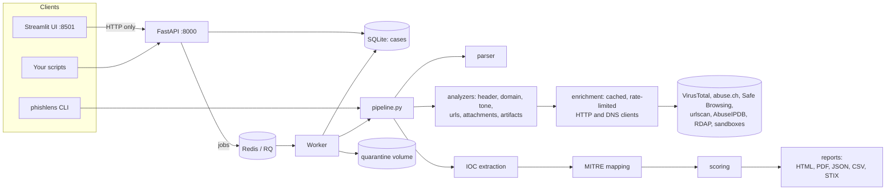

# PhishLens

**Upload one email file and get a complete, explainable phishing investigation in a single report.**

PhishLens takes a suspicious email (`.eml` or Outlook `.msg`), or any single file, and runs a
static investigation of it. It checks headers, sender identity, text, links, attachments and
hidden tricks, asks free threat-intelligence services about what it found, and returns:

- a verdict (**Clean / Suspicious / Malicious**) with a 0–100 score, a confidence value, and
  the reasons behind it;
- a defanged IOC table, a MITRE ATT&CK mapping, and HTML / PDF / JSON / CSV / STIX 2.1 reports.

You can use it from a web UI, a command line tool or a REST API. It is self-hosted and needs no
paid service.

---

## What it checks: the 7 analysis steps

| # | Step | What PhishLens looks at |
|---|------|------------------------|
| 1 | **Parsing** | Reads `.eml` and `.msg` into headers, addresses, text and HTML bodies, links and attachments. Oversized or broken input is rejected before analysis starts. |
| 2 | **Header authentication** | Verifies SPF, DKIM and ARC itself, and **recomputes DMARC alignment** against the visible From domain. It notices forged `Authentication-Results` headers, mail that authenticates only for some other domain, known bulk-mail providers, and Received-chain anomalies. |
| 3 | **Sender and domain** | Compares From, Reply-To, Return-Path and Sender. Detects lookalike domains (typos, homoglyphs, TLD swaps, punycode), display-name tricks, domains registered in the last few days (RDAP), missing mail servers, and **identity binding** (below). |
| 4 | **Body tone** | Scores urgency, fear, rewards, authority, secrecy, generic greetings, and requests for passwords or payments, using editable lexicons. An optional local ML model and an optional Claude check can add a second opinion. |
| 5 | **URLs** | Collects links from the text, the HTML, attachments and QR codes. Flags IP hosts, shorteners, risky TLDs, mismatched link text and credential-page keywords. Checks reputation with VirusTotal, Google Safe Browsing, URLhaus and urlscan.io. Pages are **never fetched** from your machine. |
| 6 | **Attachments** | Identifies files by their bytes and unpacks archives (zip, 7z, tar, gz, ISO) in memory, trying passwords given in the email. Inspects Office macros, PDF actions, HTML smuggling, PE/LNK files and QR codes, runs YARA rules, and looks up hashes. Sandbox submission is optional; files are uploaded only if you allow it. |
| 7 | **Hidden artifacts** | Finds hidden text, zero-width characters, tracking pixels, text/HTML mismatches, scripts, meta refreshes, encoded links and header oddities. |

Afterwards PhishLens extracts and defangs the IOCs, maps findings to MITRE ATT&CK, and scores
everything with transparent weights.

## What makes it different

- **Identity binding.** "Who does this email claim to be?" (brand in the display name,
  lookalike domain, subject, body) is compared with "who actually sent it and proved it?" (the
  DMARC-aligned From domain). Claiming PayPal while authenticating as `paypa1-secure.example`
  is caught, even when every individual check passes.
- **Alignment is recomputed, never trusted.** PhishLens re-verifies SPF, DKIM and ARC and works
  out DMARC alignment itself, instead of believing the receiving server's
  `Authentication-Results` header (which an attacker can forge).
- **Explainable scoring.** Every point on the score comes from a named finding with a weight in
  `data/weights.yaml`. Each module's contribution is capped, and override rules are listed in
  the report. There are no black-box decisions.
- **Analyst-ready output.** Defanged IOC table (CSV/JSON), STIX 2.1 bundle, MITRE ATT&CK
  techniques with the findings that triggered them, and an HTML/PDF report with an executive
  summary and recommended actions.
- **Free and self-hosted.** Every external service is optional and has a free tier. Without
  keys, PhishLens still runs all local checks and lowers its confidence value.
- **Private by default.**
  - Analysis is static: nothing is opened, executed, rendered or fetched.
  - Files are never uploaded to third parties unless you allow it.
  - API keys are never logged.
  - Every malicious value in every output is defanged (`hxxp://evil[.]com`).

## Architecture



See [docs/ARCHITECTURE.md](docs/ARCHITECTURE.md) for the analyzers, the finding contract,
scoring, and how to extend the data files.

## Quick start with Docker

```bash
git clone https://github.com/rahulllyadavvv/PhishLens.git
cd PhishLens
cp .env.example .env        # optional: add the API keys you have
make up                     # = docker compose up -d --build
```

- UI: <http://localhost:8501>. Drop an `.eml` / `.msg` file on the Analyze page.
- API: <http://localhost:8000> (interactive docs at `/docs`)
- Stop: `make down`. Cases, reports and caches stay in the `data` volume.

The image includes libmagic, zbar and the WeasyPrint libraries, so every check and the PDF
report work inside Docker.

## Local install (without Docker)

Requires Python 3.11.

```bash
python -m venv .venv && source .venv/bin/activate
pip install -e ".[dev]"
# optional system libraries (macOS shown; Debian/Ubuntu: libmagic1 libzbar0 libpango-1.0-0)
brew install libmagic zbar pango
```

- Without libmagic, file types are detected from built-in signatures.
- Without zbar, QR codes are not decoded.
- Without Pango, PDF reports are skipped.

Details are in [docs/SETUP_NOTES.md](docs/SETUP_NOTES.md).

```bash
phishlens check-config                       # which services are enabled (never shows keys)
uvicorn api.main:app --reload                # API (JOB_QUEUE=sync runs jobs in-process)
streamlit run ui/app.py                      # UI, talks to the API
```

## API keys (all optional, all free tiers)

Put keys in `.env` (see `.env.example`). A missing key disables only that service.

| Service | Used for | Setting | Sign up | Free tier notes |
|---|---|---|---|---|
| VirusTotal | hash, URL, domain and IP reputation | `VIRUSTOTAL_API_KEY` | <https://www.virustotal.com/gui/join-us> | Public API: about 4 requests/min and 500/day; not for commercial use |
| abuse.ch | MalwareBazaar hashes, URLhaus URLs | `ABUSECH_API_KEY` | <https://auth.abuse.ch/> | Free Auth-Key |
| Google Safe Browsing | phishing and malware URL lists | `GOOGLE_SAFEBROWSING_API_KEY` | <https://developers.google.com/safe-browsing/v4/get-started> | Free with a Google Cloud project; non-commercial use |
| urlscan.io | remote page scan, screenshot, final URL | `URLSCAN_API_KEY` | <https://urlscan.io/user/signup> | Daily scan quotas; scans default to *unlisted* here |
| AbuseIPDB | sending IP reputation | `ABUSEIPDB_API_KEY` | <https://www.abuseipdb.com/register> | About 1,000 checks/day |
| Hybrid Analysis | sandbox reports | `HYBRID_ANALYSIS_API_KEY` | <https://www.hybrid-analysis.com/signup> | Free account; uploads need `UPLOAD_FILES_TO_HYBRID_ANALYSIS=true` |
| CAPE | your own sandbox | `CAPE_BASE_URL` | <https://github.com/kevoreilly/CAPEv2> | Self-hosted |
| Claude (Anthropic) | optional second opinion on tone | `LLM_API_KEY` + `LLM_TONE_ENABLED=true` | <https://console.anthropic.com/> | Pay per use; sends the email text to Anthropic |

Quotas change; check each provider's site. PhishLens caches every answer (SQLite) and rate
limits each service, so repeated analyses do not use up your quota.

## Getting the email file

The analysis needs the **original message with its headers**. Screenshots, copied text and
forwards lose them.

| Mail client | How |
|---|---|
| Gmail | Open the message → ⋮ (next to Reply) → **Download message** → `.eml` |
| Outlook desktop | Open the message → **File → Save As** (or drag it to the desktop) → `.msg` |
| Outlook on the web | Open the message → … → **Download** → `.eml` |
| Apple Mail | Select the message → **File → Save As…** → format *Raw Message Source* → `.eml` |
| Thunderbird | Right-click the message → **Save As…** → `.eml` |

You can also paste the raw source in the UI (Gmail: ⋮ → **Show original** → Copy to clipboard).

## Usage

### Web UI

- **Analyze**: upload an email, one or more files, or paste the source, then follow the live
  progress.
- **Case view**: verdict, score, summary, and a tab per analysis area (headers, sender, body
  with highlighted phrases, URLs with urlscan screenshots, attachments with the archive tree,
  IOCs, MITRE, all findings). You can download every report format from here.
- **History**: statistics, a 30-day chart, and a searchable, filterable, paginated case list
  with open and delete.
- **Settings**: which services are configured, queue status, thresholds, and how PhishLens
  works.

### CLI

```bash
phishlens analyze suspicious.eml --format json,html --out reports/
phishlens analyze suspicious.msg --format html,pdf,csv,stix,zip --no-network
phishlens analyze-file invoice.zip --format json
phishlens check-config
```

The verdict, score and top reasons are printed in the terminal, and the chosen report formats
are saved in `--out`. The exit code is 1 when the input cannot be read.

### REST API

```bash
# submit (returns {"case_id": "PL-20260925-AB12C", "duplicate": false})
curl -F file=@suspicious.eml http://localhost:8000/api/analyze
curl -F files=@invoice.zip http://localhost:8000/api/analyze-file
# follow and fetch
curl http://localhost:8000/api/cases/PL-20260925-AB12C/status
curl http://localhost:8000/api/cases/PL-20260925-AB12C
curl -OJ "http://localhost:8000/api/cases/PL-20260925-AB12C/report?format=pdf"
```

Other endpoints:
- `POST /api/analyze-raw` (pasted source);
- `GET /api/cases` with filters `verdict`, `case_type`, `date_from`, `date_to`, `q` and
  paging;
- `GET /api/stats`, `DELETE /api/cases/{id}` and `GET /api/health`.

Details:
- An input that was already analyzed returns the existing case. Add `?force=true` to analyze
  it again.
- Set `PHISHLENS_API_KEY` to require an `X-API-Key` header.
- Uploads are rate limited per client IP (`UPLOAD_RATE_LIMIT`, default 20 per minute). Behind
  a reverse proxy, run uvicorn with `--proxy-headers --forwarded-allow-ips=<proxy IP>` so the
  limit applies to real client addresses.

## Evaluation

`scripts/evaluate.py` measures PhishLens on a labelled folder of emails. It reports:
- confusion matrix, precision, recall, F1 and false positive rate;
- time per email and how much each module contributed;
- agreement with an analyst's manual verdicts, and the misclassified emails;
- with `--tune`, a precision/recall trade-off across threshold pairs.

```bash
python scripts/evaluate.py samples/eval --labels samples/eval/labels.csv --tune
python scripts/evaluate.py samples/eval --labels samples/eval/labels.csv --cached-only  # no new API calls
```

Results (to be filled in with a real dataset; see `scripts/prepare_datasets.md`):

| Dataset | Emails | Precision | Recall | F1 | False positive rate | Avg time / email |
|---|---|---|---|---|---|---|
| Synthetic fixtures (sanity check only) | 14 | – | – | – | – | – |
| Phishing corpus + legitimate mail | – | – | – | – | – | – |

## Safety

- **Static analysis only.** Attachments and links are never opened, executed, rendered or
  fetched on the host. Dynamic analysis happens only in an external sandbox you configure.
- **No uploads without consent.** Only hashes and URL strings are looked up. Files go to
  VirusTotal or Hybrid Analysis only with `UPLOAD_FILES_TO_VT=true` /
  `UPLOAD_FILES_TO_HYBRID_ANALYSIS=true`.
- **Defanged everywhere.** Reports, CLI output, API responses and the UI show
  `hxxp://evil[.]com`. Only MITRE ATT&CK and urlscan.io screenshot links are clickable.
- **Quarantine.** Uploads and attachments are stored under `quarantine/` with generated names
  (attachments in an encrypted zip). This folder is never served, and the UI container cannot
  reach it.
- **Secrets.** API keys are held as secrets, never logged or returned, and `check-config`
  shows only enabled/disabled.
- Handle real phishing samples with care; keep them in `samples/` (gitignored).

## Limitations

- **Compromised legitimate accounts.** Mail sent from a real, hijacked mailbox passes SPF,
  DKIM and DMARC and has no lookalike domain. PhishLens then relies on content, links and
  attachments, and may rate it lower than it deserves.
- **No inline blocking.** PhishLens investigates emails you submit. It is not a mail gateway
  and does not stop delivery.
- **Free-tier limits.** Reputation coverage depends on the keys you add and their quotas.
  Without them, confidence drops and newly created URLs or files may be unknown to every
  service.
- **Static only.** Payloads that reveal themselves only when run need a sandbox.
  Password-protected archives are opened only when the password appears in the email.
- Lexicons and brand lists are English-centric and need tuning for your organization.

## Roadmap

- Mailbox integration: poll an IMAP/Graph "report phishing" folder, then reply to the reporter
  with the verdict (phase 16 of the build guide).
- Response actions: block-list export and ticket creation.
- A trained scorer (`SCORER=ml`) from evaluation data exported with `scripts/export_features.py`.
- More languages for the tone lexicons.

## Development

```bash
make test      # pytest; all network is mocked (a test that tries a real connection fails)
make lint      # ruff check .
make fixtures  # regenerate the synthetic test emails
make evaluate  # evaluation on the fixtures without network
```

- Project rules for contributors, including AI assistants, are in [CLAUDE.md](CLAUDE.md).
- Design decisions are in [docs/DECISIONS.md](docs/DECISIONS.md).
- The step-by-step build guide is in [docs/PROMPTS.md](docs/PROMPTS.md).

## License

MIT. See [LICENSE](LICENSE).
